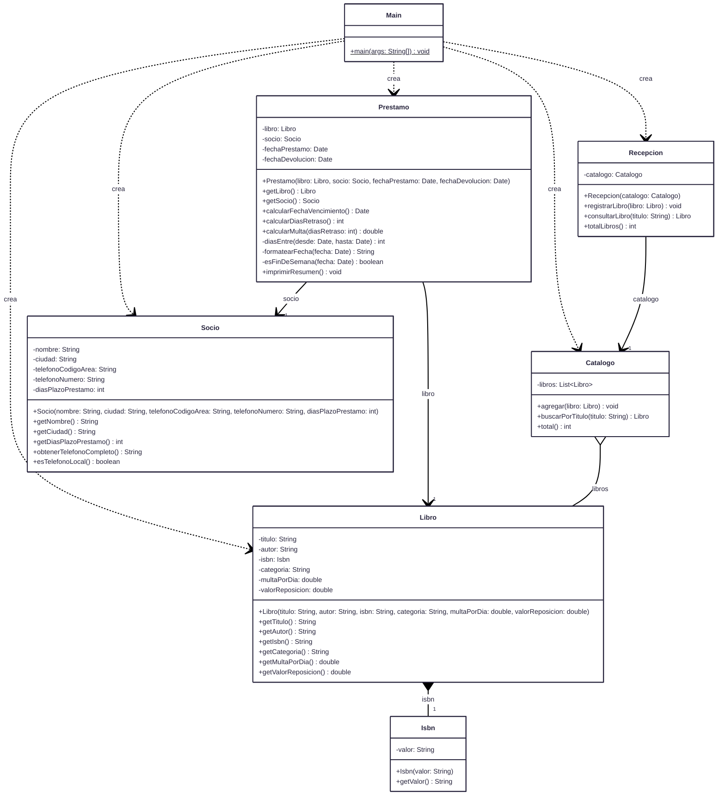
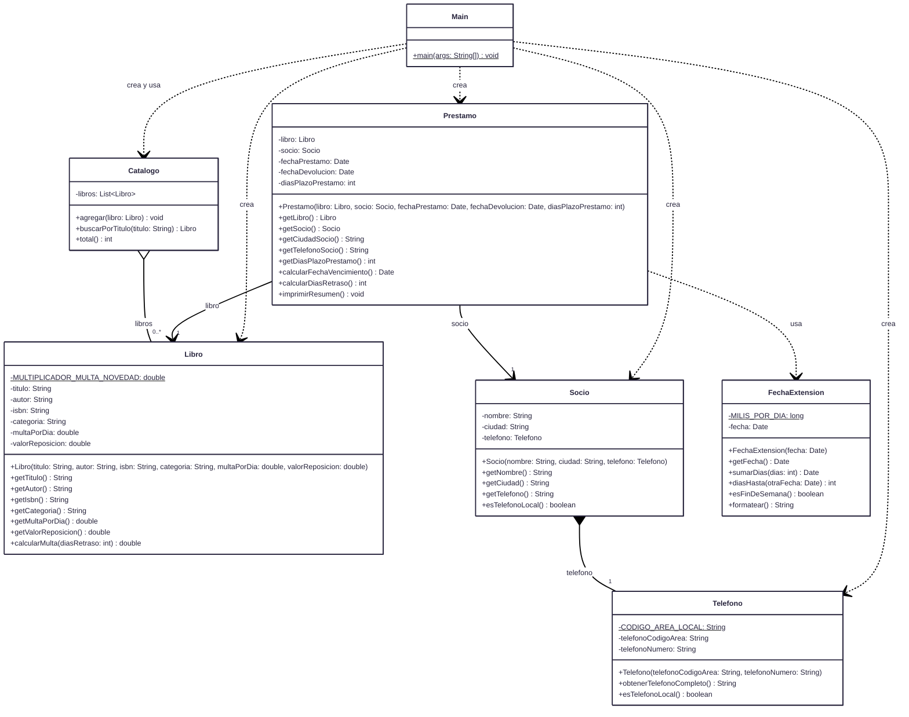

# Sistema de Gestión de Biblioteca - Refactorización

## Codigo

El codigo fuente se encuentra en [`src/biblioteca/`](src/biblioteca/).

## Diagrama de clases - Antes de la refactorización

## Diagrama de clases — Después de la refactorización

