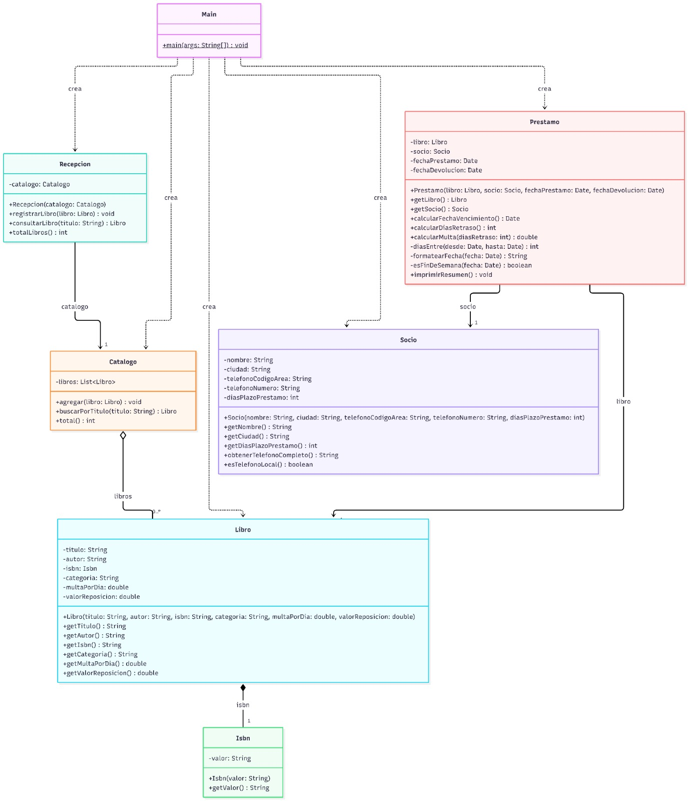
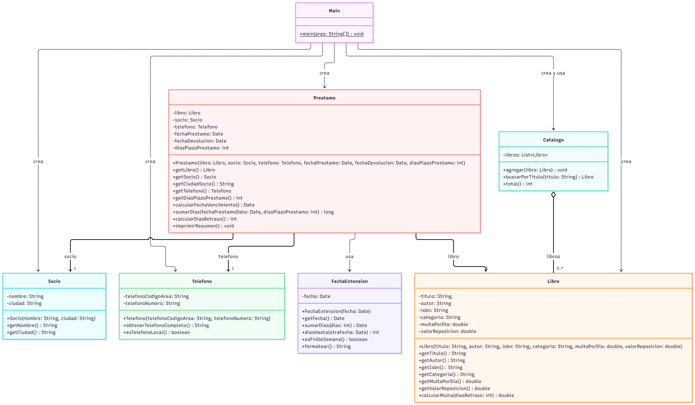

# Diagramas
## Pre refactorizacion

## Post refactorizacion

## Tabla Resumen de las refactorizaciones

| # | Refactorización | Origen | Destino | Elemento movido/cambiado |
|---|----------------|--------|---------|--------------------------|
| 1 | Inline Class | `Isbn` | `Libro` | Clase `Isbn` eliminada. `isbn` pasa a `String` |
| 2 | Extract Class | `Socio` | `Telefono` | Atributos y métodos de teléfono |
| 3 | Move Field | `Socio` | `Prestamo` | `diasPlazoPrestamo` |
| 4 | Move Method | `Prestamo` | `Libro` | `calcularMulta()` |
| 5 | Remove Middle Man | `Recepcion` | `Main`→`Catalogo` | Delegación directa |
| 6 | Hide Delegate | `Main` | `Prestamo` | `getCiudadSocio()` |
| 7 | Introduce Local Extension | `Prestamo` | `FechaExtension` | Métodos de fecha |
| 8 | Introduce Foreign Method | — | `Prestamo` | `sumarDias()` |

